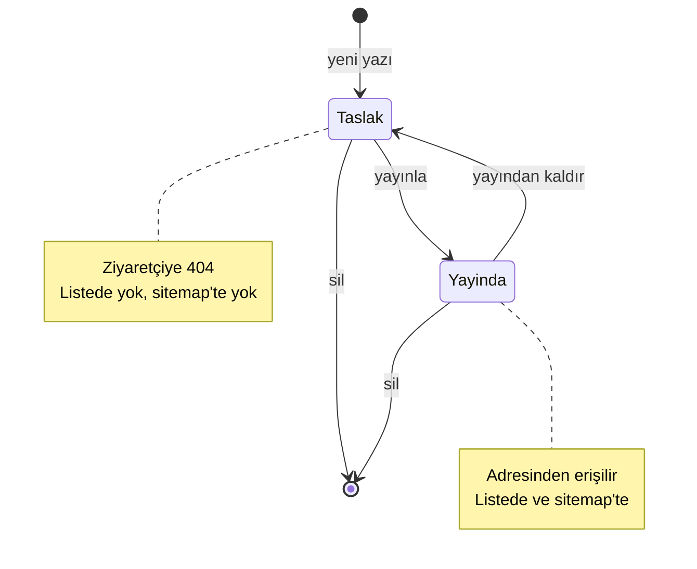
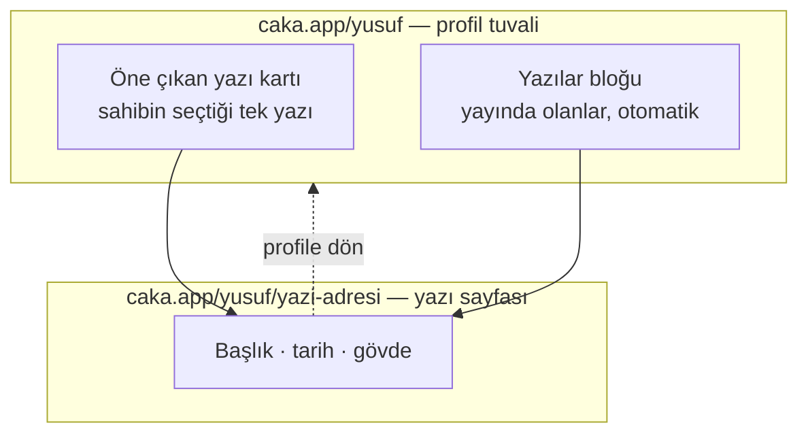

# Yazı Sayfaları - Plan

## Goal Capsule

- **Amaç:** Profil sahibi uzun metin yazıp `caka.app/kullaniciadi/yazi-adresi` adresinde yayınlayabilsin; yazılar profil tuvaline iki blokla bağlansın.
- **Ürün yetkisi:** Bu plan yalnızca yazı alanını sahiplenir. Shopify entegrasyonu, reklam widget'ları, ücretli subdomain katmanı ve milestones tarzı zaman çizgisi bloğu aktif kapsam değildir — bunlar bağlamdır, gereksinim değil.
- **Açık engel:** Yok. Planlamayı bloklayan çözülmemiş ürün sorusu kalmadı; ertelenen sorular `Outstanding Questions` altında sınıflı duruyor.

---

## Product Contract

### Summary

Profil sahibinin uzun metin yayınlayabildiği bir yazı özelliği. Her yazı profilin altında kendi adresinde, kendi taslak/yayın durumuyla yaşar. Tuvale iki blokla bağlanır: otomatik büyüyen bir yazı listesi ve tek bir yazıyı öne çıkaran kart.

### Problem Frame

Caka bugün tek ekrandır: her içerik bir bloğun içine sığmak zorundadır. Metin katmanı bunu varsayarak kurulmuş — `text` bloğu 280 karakter, zengin metin dokümanı blok başına 8 KB, izin listesinde başlık, görsel ve kod bloğu yok (`apps/web/app/components/rich-text.tsx`, `packages/shared/src/layout.ts`).

Profil sahibi birkaç paragraftan uzun bir şey anlatmak istediğinde yapabileceği tek şey dışarıya bağlantı vermektir. O bağlantı ziyaretçiyi Caka'dan çıkarır ve yazının kendisi profilin bir parçası olmaz: paylaşılan adres Caka'ya ait değildir, profil sayfasının SEO'suna hiçbir şey katmaz, sahibin denetiminde de değildir.

Talebin kaynağı ölçülmüş bir kullanım değil, tek bir kullanıcının kendiliğinden gelen önerisidir. Bu, özelliğin dayandığı en zayıf halkadır ve `Dependencies / Assumptions` altında varsayım olarak kayıtlıdır.

### Key Decisions

- **Yazı, genel bir "sayfa" sistemi değil, tek amaçlı bir içerik türüdür.** Shopify ürün kartları modal açacağı için ortak bir sayfa primitifinin ikinci müşterisi yok; genellik bugün bedelini çıkarmıyor. *(session-settled: user-approved — genel sayfa primitifi yerine seçildi: Shopify'ın modal olacağı bilgisi ortak primitifin gerekçesini kaldırdı.)* Governs R1, R6.

- **Yazı adresi profilin altında yaşar.** Ücretli subdomain katmanı geldiğinde `yusuf.caka.app/yazi-adresi` birebir aynı şekle oturur; ara bir segment seçilseydi ücretsiz ve ücretli katmanın yolları ayrışırdı. *(session-settled: user-approved — `/kullanici/s/yazi-adresi` ve `/s/kullanici/yazi-adresi` yerine seçildi: subdomain planıyla tek yol eşlemesi kurulsun diye.)* Governs R2, R3, R5.

- **Profil-içi rezerve slug listesi bu turda kurulur.** Kullanıcı içeriği profil isim alanını kalıcı sahiplendiği için, sistem yollarına ayrılacak kelimeler ilk yazı yayınlanmadan önce kapatılmalıdır; sonradan geri alınamaz. Governs R3.

- **Yazı kendi yayın durumunu taşır.** Profilin mevcut taslak/yayın mekanizması tuvalin tamamını yayınlar; bir yazıdaki yazım hatasını düzeltmek için tüm tuvali yayınlamak zorunda kalmak kabul edilemez. Bunun bedeli, üründe "yayınla" sözcüğünün iki ayrı işi adlandırmasıdır. Governs R4, R11.

- **Tuvalde hem liste hem öne çıkan blok bulunur.** Tek liste bloğu tuvali temiz tutar ama tek bir yazıyı öne çıkarmaya izin vermez; her yazıya ayrı blok tuvali doldurur. *(session-settled: user-directed — tek liste bloğu ve yazı-başına-blok seçenekleri yerine seçildi: tuval kontrolü korunsun diye, iki katına yakın iş kabul edilerek.)* Governs R10, R11.

<!-- ce-section: work-relationships -->
### How This Work Fits Together

Bu plan yalnızca **yazı sayfalarını** sahiplenir. Aşağıdaki alanlar aynı geri bildirim turundan çıktı ve bugünkü anlayışı yansıtır — taahhüt edilmiş bir yol haritası değildir; sonraki bir plan bunları bölebilir, birleştirebilir veya tamamen iptal edebilir.

- **Gelen kaynak analitiği ve halka grafik** — Can proceed independently of bu plandan. Ayrı bir ölçüm işi; yazı sayfalarının kendi görüntülenme ölçümü ileride bu hattı kullanabilir.
- **Shopify entegrasyonu** — Shares tuval blok modelini, ama detayı modal olarak açar; yazı sayfalarının adres ve SEO mekanizmasını kullanmaz.
- **Reklam alanı widget'ları** — Can proceed independently of bu plandan. Still to decide: profil sayfasında reklam, `docs/legal/` içinde bugün olmayan bir reklam açıklama yükümlülüğü doğurur.
- **Ücretli subdomain katmanı** — Depends on bu planın adres kararına (R2). Enables yazı adreslerinin `kullanici.caka.app/yazi-adresi` biçiminde sunulmasını. Still to decide: iki adresten hangisi canonical olur.
- **Milestones tarzı zaman çizgisi bloğu** — Can proceed independently of bu plandan. Farklı bir ihtiyaç (kısa, tarihli, yapılandırılmış olaylar); sayfa gerektirmez, mevcut blok modeline oturur.

### Actors

- A1. **Profil sahibi** — yazıyı yazar, yayınlar, tuvale bağlar, geri taslağa alır, siler.
- A2. **Ziyaretçi** — yayında olan yazıyı okur; oturumu yoktur.
- A3. **Arama motoru ve paylaşım önizleyicisi** — yazı sayfasını indeksler ve paylaşım kartını üretir.

### Requirements

**Yayın ve adresleme**

- R1. Profil sahibi başlık ve uzun gövdeden oluşan bir yazı oluşturabilir, düzenleyebilir ve silebilir.
- R2. Yayında olan her yazı `caka.app/<kullaniciadi>/<yazi-adresi>` adresinden erişilebilir.
- R3. Yazı adresi `[a-z0-9-]` alfabesinde 3-80 karakterdir, profil içinde benzersizdir ve profil-içi rezerve slug listesindeki kelimeleri alamaz. Liste en az şunları içerir: `hakkinda`, `iletisim`, `magaza`, `abone`, `rss`, `sitemap`, `og`, `api`, `s`.
- R4. Her yazı bağımsız bir yayın durumu taşır (taslak veya yayında). Taslak yazı yalnızca sahibine görünür; ziyaretçiye 404 döner.
- R5. Kullanıcı adı değiştiğinde eski adresteki yazı adresleri de 30 gün boyunca yeni adrese 302 ile yönlendirilir. Bu, mevcut adres değişikliği semantiğinin (Değişmez #10) alt yolları da taşıyacak şekilde genişlemesi demektir.

**İçerik ve sınırlar**

- R6. Yazı gövdesi başlık, paragraf, liste, alıntı, bağlantı, görsel ve kod bloğu taşıyabilir. Render izin listesi genişletilmeden yeni düğüm tipi üretilmez — `rich-text.tsx` bilinmeyen düğümü reddetmez, sessizce düz metne düşürür.
- R7. Yazı gövdesi en fazla 50 KB'dır. Bu, mevcut blok başına 8 KB zengin metin sınırından ayrıdır ve onu değiştirmez.
- R8. Bir profil en fazla 20 yazı taşır; başlık en fazla 120 karakterdir.
- R9. Yazı içindeki görseller mevcut varlık (asset) hattını ve kota kurallarını kullanır; yazı silindiğinde kullanılmayan görseller hesap silme davranışıyla tutarlı biçimde ele alınır.

**Tuval bağlantısı**

- R10. Sahip tuvale "yazılar" bloğu koyabilir; blok, yayında olan yazıları en yeniden eskiye otomatik listeler.
- R11. Sahip tuvale "öne çıkan yazı" bloğu koyabilir ve tek bir yazı seçer. Seçili yazı taslağa alınır veya silinirse blok public sayfada render edilmez ve editörde sahibine uyarı gösterilir.
- R12. Her iki blok da public profil sayfasının mevcut JS'siz statik render modelini korur.

**Keşfedilebilirlik ve paylaşım**

- R13. Yayında olan yazılar sitemap'e girer; taslak yazılar girmez.
- R14. Yazı sayfası kendi meta etiketlerini, canonical adresini ve paylaşım görselini taşır.
- R15. Yazı sayfası ziyaretçinin dil önekini almaz — profil sayfalarıyla aynı davranır. Yazı gövdesi sahibin yazdığı dildedir; sayfadaki arayüz metinleri beş dilli katalog düzenine girer.

**Hukuki ve veri**

- R16. Yazı, kullanıcı içeriğidir ve mevcut yer sağlayıcı rejimine tabidir: önceden denetlenmez, bildirim üzerine kaldırılır. Bu yüzden yeni bir hukuki metin gerekmez.
- R17. Yazı verisi `docs/legal/data-map.md` içine yeni bir kalem olarak girer.

### Key Flows

- F1. **Yazı yazma ve yayınlama**
  - **Tetikleyici:** Sahip yeni yazı açar.
  - **Aktörler:** A1
  - **Adımlar:** Başlık ve adres girilir → gövde yazılır → taslak olarak saklanır → sahip yayınla der → yazı adresinden erişilebilir olur.
  - **Karşılayan:** R1, R2, R3, R4

- F2. **Ziyaretçinin yazıya ulaşması**
  - **Tetikleyici:** Ziyaretçi profil sayfasındaki yazı bloğuna tıklar veya doğrudan yazı adresine gelir.
  - **Aktörler:** A2, A3
  - **Adımlar:** Yazı sayfası sunucuda render edilir → başlık, tarih ve gövde gösterilir → profile geri dönüş bağlantısı bulunur.
  - **Karşılayan:** R2, R10, R11, R12, R14

- F3. **Yayından kaldırma ve silme**
  - **Tetikleyici:** Sahip yazıyı taslağa alır veya siler.
  - **Aktörler:** A1
  - **Adımlar:** Yazı listeden düşer → adresi ziyaretçiye 404 verir → öne çıkan blok onu gösteriyorsa public'te render edilmez ve editörde uyarı çıkar → sitemap'ten düşer.
  - **Karşılayan:** R4, R11, R13

Yazının yaşam döngüsü ve görünürlüğü:

Tuval ile yazı sayfasının ilişkisi:

### Acceptance Examples

- AE1. **Karşılayan R4.** Sahip bir yazıyı taslakta bırakır. Ziyaretçi yazı adresine gider. Sayfa 404 verir; yazı başlığı hiçbir yerde sızmaz.
- AE2. **Karşılayan R4.** Sahip oturumu açıkken kendi taslak yazısının adresine gider. Yazıyı görür.
- AE3. **Karşılayan R11.** Öne çıkan blok bir yazıyı gösterirken sahip o yazıyı siler. Public profil sayfasında blok render edilmez; editörde sahibe blokun boşa düştüğü bildirilir.
- AE4. **Karşılayan R3.** Sahip yazı adresi olarak `hakkinda` girer. Adres reddedilir ve sahibe bu adresin ayrılmış olduğu söylenir.
- AE5. **Karşılayan R5.** Sahip kullanıcı adını `yusuf`tan `yusufy`ye değiştirir. `caka.app/yusuf/ilk-yazim` adresi 30 gün boyunca `caka.app/yusufy/ilk-yazim` adresine 302 ile yönlendirir.
- AE6. **Karşılayan R8.** Profilde 20 yazı varken sahip yeni yazı açmayı dener. İşlem reddedilir ve sınıra ulaşıldığı bildirilir.
- AE7. **Karşılayan R10, R13.** Sahip yeni bir yazı yayınlar. Yazı, tuvaldeki yazılar bloğunun en üstünde belirir ve sitemap'e girer; sahip tuvali yeniden yayınlamak zorunda kalmaz.

### Scope Boundaries

**Sonraya ertelendi**

- Ücretli subdomain katmanı (`kullanici.caka.app`). Adres kararı (R2) onunla uyumlu kuruldu ama bu turda yapılmıyor.
- Yazı bazlı görüntülenme ölçümü. Mevcut analitik hattı profil düzeyinde çalışıyor; yazı kırılımı ayrı bir iş.
- RSS/Atom beslemesi, yorum, abonelik, e-posta bülteni.
- Dışarıdaki yazıların dizini (RSS veya elle girilen bağlantı kartları). Yazı barındırmanın üstüne ucuz bir ek olarak sonradan gelebilir.
- Milestones tarzı zaman çizgisi bloğu.

**Ürünün kimliğinin dışında**

- Çoklu yazar, taslak paylaşımı, düzenleme geçmişi, yayın zamanlaması. Caka bir yayın platformu değil; bunlar onu CMS'e çevirir.
- Yazı için ayrı tema, özel CSS veya sayfa düzeni editörü. Yazı sayfası profil temasını izler.
- Shopify ürünlerinin kendi adreslenebilir sayfaları. Ürünün gerçek sayfası Shopify'da; Caka'daki kart modal açar.
- Profil sayfalarında reklam alanları.

### Dependencies / Assumptions

- **Talep varsayımı.** Özelliğin arkasında ölçülmüş kullanım yok; kanıt, değer verilen tek bir kullanıcının kendiliğinden gelen önerisidir. Kimin yazacağı ve bugün bunu nerede yaptığı bilinmiyor. Yanlışsa en ucuz düzeltme, yazı barındırmayı bırakıp dış yazıların dizinine dönmektir.
- **Zengin metin genişletmesi.** R6 mevcut izin listesinin genişletilmesine bağlıdır. Genişletilmezse editörün ürettiği başlık ve kod blokları sessizce düz metne düşer.
- **Adres değişikliği semantiği.** R5, bugünkü yönlendirmenin alt yolu düşürmesi nedeniyle Değişmez #10'un genişletilmesini gerektirir.
- **Rezerve slug zamanlaması.** R3'ün değeri ilk yazı yayınlanmadan önce uygulanmasına bağlıdır. Sonradan eklenen kelimeler mevcut adresleri kıramaz.
- **Varlık kotası.** R9, mevcut varlık kotası kurallarının yazı görsellerini de kapsamasına bağlıdır.

### Outstanding Questions

**Planlamada çözülecek**

- Yazı editörünün nerede yaşayacağı: mevcut tuval editörünün içinde mi, kendi tam ekran yüzeyinde mi.
- Yazı gövdesinin nerede saklanacağı ve mevcut zengin metin şemasıyla ilişkisi.
- Silinen yazının görsellerinin temizlenme anı ve hesap silme akışıyla ilişkisi.
- Yazı sayfasının paylaşım görselinin mevcut og üretim hattından mı türetileceği.

**Sonraki brainstorm'a bırakıldı**

- Ücretli subdomain geldiğinde `caka.app/kullanici/yazi` ile `kullanici.caka.app/yazi` arasında hangisinin canonical olacağı ve paylaşılmış eski bağlantıların ne olacağı.
- Yazı özelliğinin ücretsiz mi kalacağı yoksa ücretli katmana mı gireceği.

### Sources / Research

Doğrulanmış depo kısıtları (11 iddianın 11'i kod tabanına karşı doğrulandı):

- `apps/web/app/components/rich-text.tsx` — izin listesinde başlık, görsel ve kod bloğu yok; bilinmeyen düğüm reddedilmez, `default` dalında düz metne düşürülür.
- `packages/shared/src/layout.ts` — `richDocSchema` blok başına 8192 karakter; `MAX_LAYOUT_SECTIONS` 8 ve bölümler kapsayıcı değil ayraçtır.
- `apps/web/app/routes.ts` — `:username` catch-all dizinin son elemanı; `/:username/` altında bugün hiçbir route tanımlı değil.
- `apps/web/server/og-image.ts` — og:image `/og/u/:username/...` altında; `/:username/og.png` bilinçli olarak reddedilmiş.
- `apps/web/app/routes/username.tsx` — adres değişikliği yönlendirmesi yalnızca `/${yeniAd}`'a atar, alt yolu taşımaz.
- `packages/shared/src/username.ts` — rezerve mantığı yalnızca tam kullanıcı adı üzerinde çalışır; profil-içi slug rezervasyonu yok. `belge` sözcüğü PDF/CV bloğu tarafından alınmış (`packages/shared/src/document.ts`).
- `packages/db/src/schema.ts` ve `apps/web/server/layout-api.ts` — profil taslak/yayın deseni: `draft_layout` canlıya kopyalanır, sürüm artar.
- `apps/web/server/seo.ts` — sitemap profil sayfalarını sayfalayarak üretir; yeni public sayfa tipi bu dosyaya dokunmayı gerektirir.
- `apps/web/app/content/legal/tr/kullanim-kosullari.ts` — 5651 sayılı Kanun kapsamında yer sağlayıcı sıfatı ve önceden denetlememe rejimi zaten ilan edilmiş.

Dış esin: milestones (`milestones.day`) — kısa, tarihli, yapılandırılmış olaylardan oluşan bir hayat portfolyosu. Bu planın konusu olan uzun serbest metinden ayrı bir şekildir ve kapsam dışında bırakıldı.
