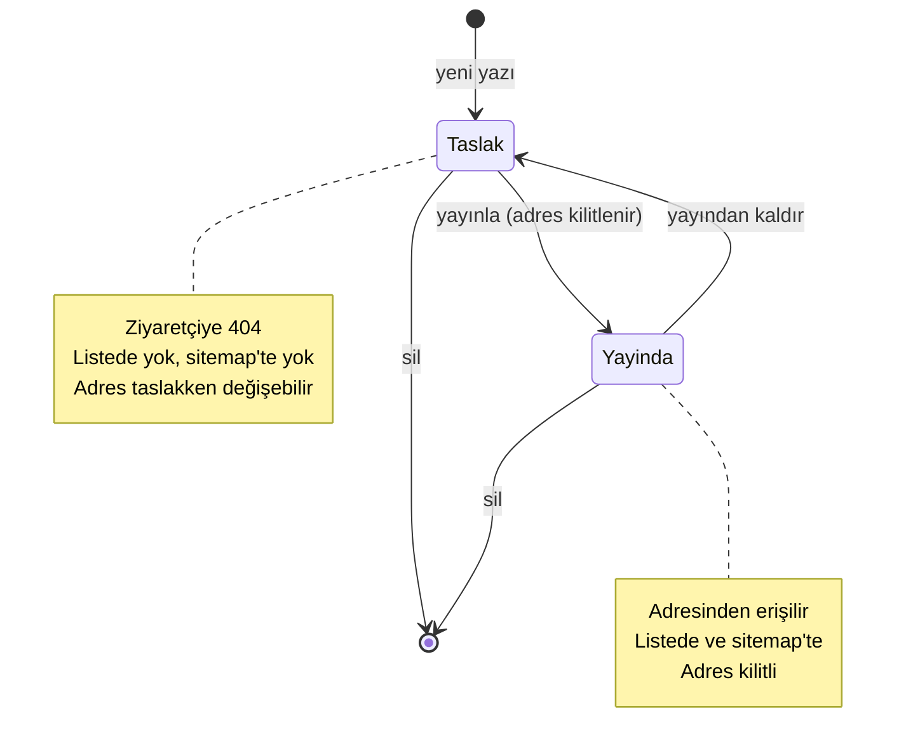
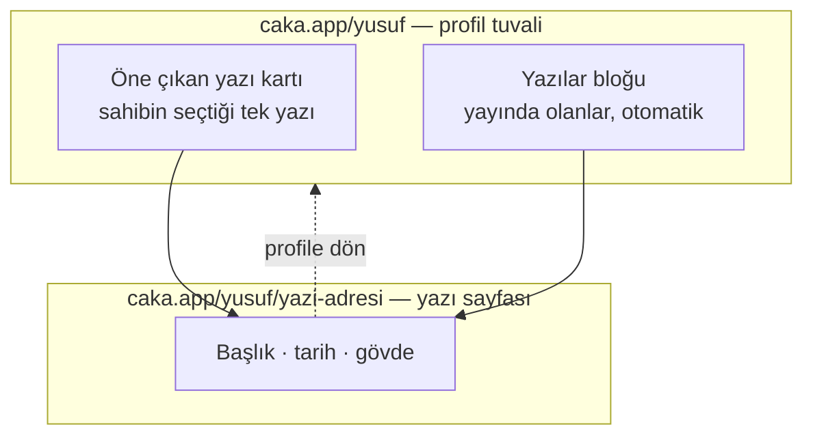
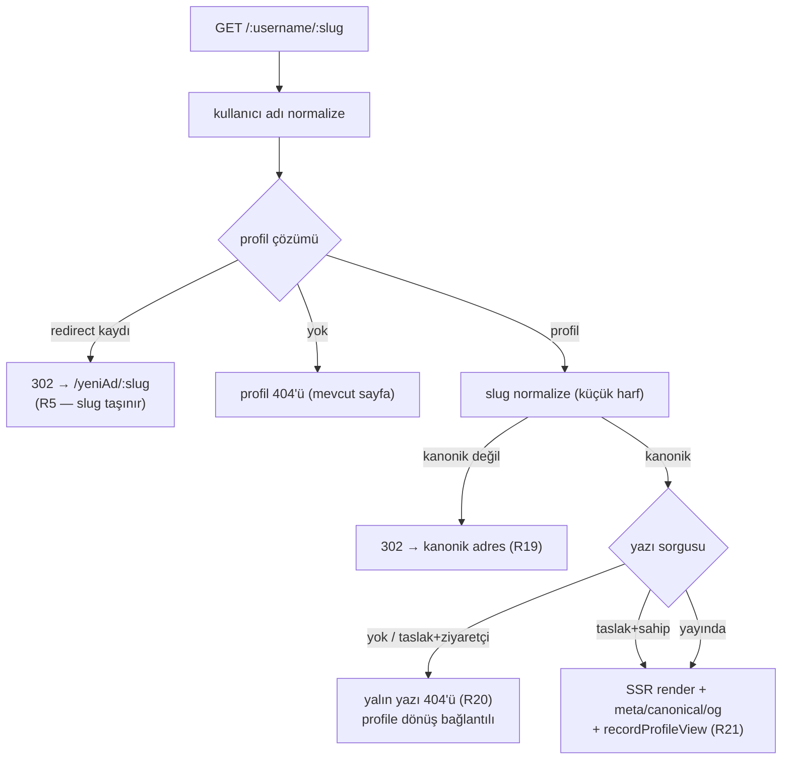
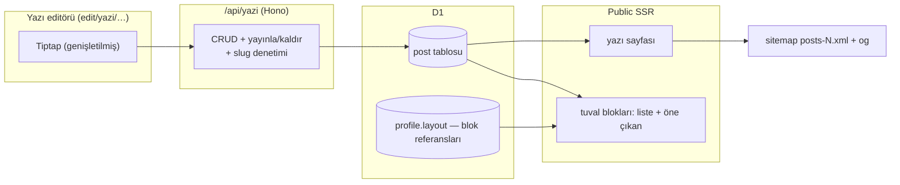

# Yazı Sayfaları - Plan

## Goal Capsule

- **Amaç:** Profil sahibi uzun metin yazıp `caka.app/kullaniciadi/yazi-adresi` adresinde yayınlayabilsin; yazılar profil tuvaline iki blokla (otomatik liste + öne çıkan kart) bağlansın.
- **Ürün yetkisi:** Bu plan yalnızca yazı alanını sahiplenir. Shopify, reklam widget'ları, ücretli subdomain ve milestones bloğu bağlamdır, gereksinim değil. Çelişkide `AGENTS.md` değişmezleri ve bu plan kazanır; `ARCHITECTURE.md` özet niteliğindedir.
- **Durma koşulları:** Bir değişmezle (özellikle #1 route senkronu, #3 migration, #9 asset silme, #10 adres semantiği) çözümsüz çelişki bulunursa iş durur ve kullanıcıya döner; kapsam genişletme (RSS, yorum, çoklu yazar) yapılmaz.
- **Yürütme profili:** `execution: code`. Kapılar Verification Contract'ta; saf kurallar test-önce yazılır, UI/route katmanı duman testiyle doğrulanır.
- **Açık engel:** Yok. Ertelenen iki soru `Outstanding Questions` altında, ikisi de bu planı bloklamaz.

**Product Contract koruma notu:** R1–R17 anlamı korundu. R18–R22 ve AE8–AE9 eklendi — planlama sırasında çözülüp kapsam onayında kabul edilen ürün davranışları. Kararların dizini Key Decisions'a tek kalem olarak işlendi.

---

## Product Contract

### Summary

Profil sahibinin uzun metin yayınlayabildiği bir yazı özelliği. Her yazı profilin altında kendi adresinde, kendi taslak/yayın durumuyla yaşar. Tuvale iki blokla bağlanır: otomatik büyüyen bir yazı listesi ve tek bir yazıyı öne çıkaran kart.

### Problem Frame

Caka bugün tek ekrandır: her içerik bir bloğun içine sığmak zorundadır. Metin katmanı bunu varsayarak kurulmuş — `text` bloğu 280 karakter, zengin metin dokümanı blok başına 8 KB, izin listesinde başlık, görsel ve kod bloğu yok (`apps/web/app/components/rich-text.tsx`, `packages/shared/src/layout.ts`).

Profil sahibi birkaç paragraftan uzun bir şey anlatmak istediğinde yapabileceği tek şey dışarıya bağlantı vermektir. O bağlantı ziyaretçiyi Caka'dan çıkarır ve yazının kendisi profilin bir parçası olmaz: paylaşılan adres Caka'ya ait değildir, profil sayfasının SEO'suna hiçbir şey katmaz, sahibin denetiminde de değildir.

Talebin kaynağı ölçülmüş bir kullanım değil, tek bir kullanıcının kendiliğinden gelen önerisidir. Bu, özelliğin dayandığı en zayıf halkadır ve `Dependencies / Assumptions` altında varsayım olarak kayıtlıdır.

### Key Decisions

- **Yazı, genel bir "sayfa" sistemi değil, tek amaçlı bir içerik türüdür.** Shopify ürün kartları modal açacağı için ortak bir sayfa primitifinin ikinci müşterisi yok; genellik bugün bedelini çıkarmıyor. *(session-settled: user-approved — genel sayfa primitifi yerine seçildi: Shopify'ın modal olacağı bilgisi ortak primitifin gerekçesini kaldırdı.)* Governs R1, R6.

- **Yazı adresi profilin altında yaşar.** Ücretli subdomain katmanı geldiğinde `yusuf.caka.app/yazi-adresi` birebir aynı şekle oturur; ara bir segment seçilseydi ücretsiz ve ücretli katmanın yolları ayrışırdı. *(session-settled: user-approved — `/kullanici/s/yazi-adresi` ve `/s/kullanici/yazi-adresi` yerine seçildi: subdomain planıyla tek yol eşlemesi kurulsun diye.)* Governs R2, R3, R5.

- **Profil-içi rezerve slug listesi bu turda kurulur.** Kullanıcı içeriği profil isim alanını kalıcı sahiplendiği için, sistem yollarına ayrılacak kelimeler ilk yazı yayınlanmadan önce kapatılmalıdır; sonradan geri alınamaz. Governs R3.

- **Yazı kendi yayın durumunu taşır.** Profilin mevcut taslak/yayın mekanizması tuvalin tamamını yayınlar; bir yazıdaki yazım hatasını düzeltmek için tüm tuvali yayınlamak zorunda kalmak kabul edilemez. Bunun bedeli, üründe "yayınla" sözcüğünün iki ayrı işi adlandırmasıdır. Governs R4, R11.

- **Tuvalde hem liste hem öne çıkan blok bulunur.** Tek liste bloğu tuvali temiz tutar ama tek bir yazıyı öne çıkarmaya izin vermez; her yazıya ayrı blok tuvali doldurur. *(session-settled: user-directed — tek liste bloğu ve yazı-başına-blok seçenekleri yerine seçildi: tuval kontrolü korunsun diye, iki katına yakın iş kabul edilerek.)* Governs R10, R11.

- **Plan aşaması ürün kararları: adres kilidi, kanonik yönlendirme, yalın 404, profil sayacı, taslak-dahil sınırlar.** *(session-settled: user-approved — kapsam onayında sunulup kabul edildi: paylaşılmış bağlantı kırılmasın ilkesinin en ucuz hâli kilit; yazı ziyaretleri panelde görünmezlik yerine profil toplamına dahil.)* Governs R18, R19, R20, R21, R22.

<!-- ce-section: work-relationships -->
### How This Work Fits Together

Bu plan yalnızca **yazı sayfalarını** sahiplenir. Aşağıdaki alanlar aynı geri bildirim turundan çıktı ve bugünkü anlayışı yansıtır — taahhüt edilmiş bir yol haritası değildir; sonraki bir plan bunları bölebilir, birleştirebilir veya tamamen iptal edebilir.

- **Gelen kaynak analitiği ve halka grafik** — tamamlandı (`feat(analitik)` commit'i); yazı sayfası ziyaretleri R21 ile aynı sayaçlara akar.
- **Shopify entegrasyonu** — Shares tuval blok modelini, ama detayı modal olarak açar; yazı sayfalarının adres ve SEO mekanizmasını kullanmaz.
- **Reklam alanı widget'ları** — Can proceed independently of bu plandan. Still to decide: profil sayfasında reklam, `docs/legal/` içinde bugün olmayan bir reklam açıklama yükümlülüğü doğurur.
- **Ücretli subdomain katmanı** — Depends on bu planın adres kararına (R2). Enables yazı adreslerinin `kullanici.caka.app/yazi-adresi` biçiminde sunulmasını. Still to decide: iki adresten hangisi canonical olur.
- **Milestones tarzı zaman çizgisi bloğu** — Can proceed independently of bu plandan. Farklı bir ihtiyaç (kısa, tarihli, yapılandırılmış olaylar); sayfa gerektirmez, mevcut blok modeline oturur.

### Actors

- A1. **Profil sahibi** — yazıyı yazar, yayınlar, tuvale bağlar, geri taslağa alır, siler.
- A2. **Ziyaretçi** — yayında olan yazıyı okur; oturumu yoktur.
- A3. **Arama motoru ve paylaşım önizleyicisi** — yazı sayfasını indeksler ve paylaşım kartını üretir.

### Requirements

**Yayın ve adresleme**

- R1. Profil sahibi başlık ve uzun gövdeden oluşan bir yazı oluşturabilir, düzenleyebilir ve silebilir.
- R2. Yayında olan her yazı `caka.app/<kullaniciadi>/<yazi-adresi>` adresinden erişilebilir.
- R3. Yazı adresi `[a-z0-9-]` alfabesinde 3-80 karakterdir, profil içinde benzersizdir ve profil-içi rezerve slug listesindeki kelimeleri alamaz. Liste şudur ve nihaidir: `yazi`, `yazilar`, `hakkinda`, `iletisim`, `magaza`, `abone`, `rss`, `sitemap`, `og`, `api`, `s` — ek kelime ihtiyacı kapsam onayına döner; geri alınamaz bir karar uygulayıcı takdirine bırakılmaz.
- R4. Her yazı bağımsız bir yayın durumu taşır (taslak veya yayında). Taslak yazı yalnızca sahibine görünür; ziyaretçiye 404 döner.
- R5. Kullanıcı adı değiştiğinde eski adresteki yazı adresleri de 30 gün boyunca yeni adrese 302 ile yönlendirilir. Bu, mevcut adres değişikliği semantiğinin (Değişmez #10) alt yolları da taşıyacak şekilde genişlemesi demektir.
- R18. Yazı adresi ilk yayınla birlikte kilitlenir; yayınlanmış (veya yayınlanıp taslağa alınmış) bir yazının adresi değiştirilemez. Taslakken serbesttir.
- R19. Kanonik olmayan yazı adresi biçimi (büyük harf, Türkçe karakter varyantı) kanonik adrese 302 ile yönlendirilir; kanonik adres meta'da canonical olarak bildirilir.
- R20. Var olan profilde olmayan yazı adresi, profile dönüş bağlantısı taşıyan yalın bir 404 alır; "bu adres boşta, kap!" çağrısı bu sayfada asla görünmez.
- R22. Yazı sınırı (R8) ve adres benzersizliği (R3) taslakları da kapsar; silinen yazının adresi aynı profilde yeniden kullanılabilir.

**İçerik ve sınırlar**

- R6. Yazı gövdesi başlık, paragraf, liste, alıntı, bağlantı, görsel ve kod bloğu taşıyabilir. Render izin listesi genişletilmeden yeni düğüm tipi üretilmez — `rich-text.tsx` bilinmeyen düğümü reddetmez, sessizce düz metne düşürür.
- R7. Yazı gövdesi en fazla 50 KB'dır. Bu, mevcut blok başına 8 KB zengin metin sınırından ayrıdır ve onu değiştirmez.
- R8. Bir profil en fazla 20 yazı taşır; başlık en fazla 120 karakterdir.
- R9. Yazı içindeki görseller mevcut varlık (asset) hattını ve kota kurallarını kullanır; yazı silindiğinde kullanılmayan görseller hesap silme davranışıyla tutarlı biçimde ele alınır.

**Tuval bağlantısı**

- R10. Sahip tuvale "yazılar" bloğu koyabilir; blok, yayında olan yazıları en yeniden eskiye otomatik listeler.
- R11. Sahip tuvale "öne çıkan yazı" bloğu koyabilir ve tek bir yazı seçer. Seçili yazı taslağa alınır veya silinirse blok public sayfada render edilmez ve editörde sahibine uyarı gösterilir.
- R12. Her iki blok da public profil sayfasının mevcut JS'siz statik render modelini korur.

**Keşfedilebilirlik ve paylaşım**

- R13. Yayında olan yazılar sitemap'e girer; taslak yazılar girmez.
- R14. Yazı sayfası kendi meta etiketlerini, canonical adresini ve paylaşım görselini taşır.
- R15. Yazı sayfası ziyaretçinin dil önekini almaz — profil sayfalarıyla aynı davranır. Yazı gövdesi sahibin yazdığı dildedir; sayfadaki arayüz metinleri beş dilli katalog düzenine girer.
- R21. Yazı sayfası görüntülenmesi profilin mevcut görüntülenme sayaçlarına yazılır (aynı bot/sahip ayıklama kurallarıyla); yazı bazlı kırılım bu planın dışındadır.

**Hukuki ve veri**

- R16. Yazı, kullanıcı içeriğidir ve mevcut yer sağlayıcı rejimine tabidir: önceden denetlenmez, bildirim üzerine kaldırılır. Bu yüzden yeni bir hukuki metin gerekmez.
- R17. Yazı verisi `docs/legal/data-map.md` içine yeni bir kalem olarak girer; hesap silmede yazı satırları da açıkça silinir.

### Key Flows

- F1. **Yazı yazma ve yayınlama**
  - **Tetikleyici:** Sahip yeni yazı açar.
  - **Aktörler:** A1
  - **Adımlar:** Başlık ve adres girilir → gövde yazılır → taslak olarak saklanır → sahip yayınla der → yazı adresinden erişilebilir olur, adres kilitlenir.
  - **Karşılayan:** R1, R2, R3, R4, R18

- F2. **Ziyaretçinin yazıya ulaşması**
  - **Tetikleyici:** Ziyaretçi profil sayfasındaki yazı bloğuna tıklar veya doğrudan yazı adresine gelir.
  - **Aktörler:** A2, A3
  - **Adımlar:** Yazı sayfası sunucuda render edilir → başlık, tarih ve gövde gösterilir → profile geri dönüş bağlantısı bulunur → görüntülenme profil sayacına işlenir.
  - **Karşılayan:** R2, R10, R11, R12, R14, R19, R21

- F3. **Yayından kaldırma ve silme**
  - **Tetikleyici:** Sahip yazıyı taslağa alır veya siler.
  - **Aktörler:** A1
  - **Adımlar:** Yazı listeden düşer → adresi ziyaretçiye 404 verir → öne çıkan blok onu gösteriyorsa public'te render edilmez ve editörde uyarı çıkar → sitemap'ten düşer.
  - **Karşılayan:** R4, R11, R13

Yazının yaşam döngüsü ve görünürlüğü:

Tuval ile yazı sayfasının ilişkisi:

### Acceptance Examples

- AE1. **Karşılayan R4.** Sahip bir yazıyı taslakta bırakır. Ziyaretçi yazı adresine gider. Sayfa 404 verir; yazı başlığı hiçbir yerde sızmaz.
- AE2. **Karşılayan R4.** Sahip oturumu açıkken kendi taslak yazısının adresine gider. Yazıyı görür.
- AE3. **Karşılayan R11.** Öne çıkan blok bir yazıyı gösterirken sahip o yazıyı siler. Public profil sayfasında blok render edilmez; editörde sahibe blokun boşa düştüğü bildirilir.
- AE4. **Karşılayan R3.** Sahip yazı adresi olarak `hakkinda` girer. Adres reddedilir ve sahibe bu adresin ayrılmış olduğu söylenir.
- AE5. **Karşılayan R5.** Sahip kullanıcı adını `yusuf`tan `yusufy`ye değiştirir. `caka.app/yusuf/ilk-yazim` adresi 30 gün boyunca `caka.app/yusufy/ilk-yazim` adresine 302 ile yönlendirir.
- AE6. **Karşılayan R8, R22.** Profilde taslak+yayın toplam 20 yazı varken sahip yeni yazı açmayı dener. İşlem reddedilir ve sınıra ulaşıldığı bildirilir.
- AE7. **Karşılayan R10, R13.** Sahip yeni bir yazı yayınlar. Yazı, tuvaldeki yazılar bloğunun en üstünde belirir ve sitemap'e girer; sahip tuvali yeniden yayınlamak zorunda kalmaz.
- AE8. **Karşılayan R19.** Ziyaretçi `/yusuf/Ilk-Yazim` yazar. 302 ile `/yusuf/ilk-yazim` adresine yönlendirilir; sayfanın canonical'ı da odur.
- AE9. **Karşılayan R18.** Sahip yayınlanmış bir yazının adresini değiştirmeyi dener. Arayüz alanı kilitli gösterir; API isteği doğrudan gelirse reddedilir.

### Scope Boundaries

**Sonraya ertelendi**

- Ücretli subdomain katmanı (`kullanici.caka.app`). Adres kararı (R2) onunla uyumlu kuruldu ama bu turda yapılmıyor.
- Yazı bazlı görüntülenme ölçümü. Mevcut analitik hattı profil düzeyinde çalışıyor; yazı kırılımı ayrı bir iş.
- RSS/Atom beslemesi, yorum, abonelik, e-posta bülteni.
- Dışarıdaki yazıların dizini (RSS veya elle girilen bağlantı kartları). Yazı barındırmanın üstüne ucuz bir ek olarak sonradan gelebilir.
- Milestones tarzı zaman çizgisi bloğu.
- Yayınlanmış yazı adresinin yönlendirmeli değişimi (bir `post_redirect` mekanizması). R18 kilidi bunu bilinçli erteler.

**Ürünün kimliğinin dışında**

- Çoklu yazar, taslak paylaşımı, düzenleme geçmişi, yayın zamanlaması. Caka bir yayın platformu değil; bunlar onu CMS'e çevirir.
- Yazı için ayrı tema, özel CSS veya sayfa düzeni editörü. Yazı sayfası profil temasını izler.
- Shopify ürünlerinin kendi adreslenebilir sayfaları. Ürünün gerçek sayfası Shopify'da; Caka'daki kart modal açar.
- Profil sayfalarında reklam alanları.

### Dependencies / Assumptions

- **Talep varsayımı.** Özelliğin arkasında ölçülmüş kullanım yok; kanıt, değer verilen tek bir kullanıcının kendiliğinden gelen önerisidir. Yanlışsa en ucuz düzeltme, yazı barındırmayı bırakıp dış yazıların dizinine dönmektir. Doğrulama sinyali: yayından sonraki gözlem penceresinde en az bir yazı yayınlamış profil sayısı izlenir (`post` tablosundan doğrudan sorgulanır, yeni analitik hattı gerektirmez); dizine-dönüş kararının girdisi bu sayıdır.
- **Zengin metin genişletmesi.** R6, editör yeteneği ile render izin listesinin eşzamanlı genişletilmesine bağlıdır; ayrışırlarsa içerik sessizce düz metne düşer.
- **Rezerve slug zamanlaması.** R3'ün değeri ilk yazı yayınlanmadan önce uygulanmasına bağlıdır. Sonradan eklenen kelimeler mevcut adresleri kıramaz.
- **Varlık kotası.** R9, mevcut varlık kotası kurallarının yazı görsellerini de kapsamasına bağlıdır.

### Outstanding Questions

**Sonraki brainstorm'a bırakıldı** (bu planı bloklamaz)

- Ücretli subdomain geldiğinde `caka.app/kullanici/yazi` ile `kullanici.caka.app/yazi` arasında hangisinin canonical olacağı ve paylaşılmış eski bağlantıların ne olacağı.
- Yazı özelliğinin ücretsiz mi kalacağı yoksa ücretli katmana mı gireceği.

---

## Planning Contract

### Key Technical Decisions

- KTD1. **Yazı ayrı `post` tablosunda saklanır, layout JSON'ında değil.** 50 KB'lık gövdeler layout dokümanını şişirir, per-yazı yayın durumu (R4) satır düzeyinde durum ister; layout `version: z.literal(1)` sözleşmesi de dokunulmadan kalır. Governs R1, R4, R7, R8.
- KTD2. **Public yazı route'u `apps/web/app/routes.ts` dizisine catch-all'dan önce düz `route(":username/:slug", ...)` olarak eklenir; beş dilli slug tablosuna girmez.** Profil sayfaları gibi dil öneği almaz (R15); `packages/shared/src/routes.ts` tablosu yalnız dil önekli uygulama route'ları içindir (L9).
- KTD3. **Yazı editörü tuval editörüne gömülmez; `edit` altında kendi tam ekran route'larında yaşar ve o route'lar beş dilli slug tablosuna + `ROUTE_FILES`'a girer.** *(session-settled: user-approved — tuval editörüne gömme yerine: 3000 satırlık `edit.tsx` uzun metin düzenlemeye sağlıklı ev olamaz.)* Governs R1.
- KTD4. **Yazı gövdesi için ayrı zengin metin şeması** (`postDoc`): başlık/görsel/kod bloğu düğümleri + 50 KB sınır. Mevcut blok şeması (8 KB, `richDocSchema`) değişmez; `rich-text.tsx` render izin listesi editör yeteneğiyle aynı birimde genişletilir (R6'nın sessiz-düşme riskine karşı). Governs R6, R7.
- KTD5. **Yazı slug kuralları yeni saf modülde** (`packages/shared/src/post-slug.ts`): normalize + doğrulama + ikinci seviye rezerve liste. `RESERVED_USERNAMES`'e karıştırılmaz — o liste top-level kullanıcı adlarını yönetir (Değişmez #1). Governs R3, R19.
- KTD6. **Paylaşım görseli mevcut `/og/` hattına yeni yol şablonu olarak eklenir** (`server/og-image.ts` hash'li URL deseni); `/:username/...` altında og üretilmez — o karar daha önce bilinçli verilmişti. Cache anahtarına başlık ve yayın tarihi girer. **Yazı og ucu yalnız `status='published'` yazılar için render eder**: taslak veya olmayan yazı genel geri-düşüş görseline düşer ve hash uyuşmazlığında güncel adrese yönlendirme yalnız yayındaki yazı için yapılır — aksi hâlde taslak başlığı PNG üzerinden sızar ve AE1 delinir. Taslağa dönüşte colo cache'te kalabilecek eski immutable PNG, kabul edilen artık risktir. Governs R4, R14.
- KTD7. **Yazı silindiğinde görselleri silinmez; temizlik hesap silmededir.** Değişmez #9 asset silmeyi yalnız hesap silmeye bağlar; yazı görselleri de aynı `asset.user_id` temizlik yolundan gider, ikinci bir silme yolu açılmaz. *(session-settled: user-approved — kapsam onayında kabul edildi.)* Governs R9.
- KTD8. **Yayındaki yazılar ayrı sitemap dosyalarında listelenir** (`/sitemaps/posts-N.xml`); profil sitemap sayfalaması değişmez. `lastmod` yazının güncellenme anından gelir. Governs R13.

### Assumptions

- Yazı listesi/öne çıkan blokların public render'ı loader'da ek D1 sorgusu demektir (profil başına en çok 20 satır); MVP ölçeğinde cache katmanı gerektirmez — mevcut "her istekte D1" kararıyla tutarlı.
- `/api/yazi` uçları `layout-api.ts`'in oturum + same-origin + Zod + boyut sınırı desenini birebir izler; yeni bir güvenlik deseni icat edilmez.

---

## High-Level Technical Design

Yazı adresi çözümleme sırası — public isteğin hangi kapılardan geçtiği:

Bileşenler ve veri akışı:

---

## Implementation Units

### U1. Saf kurallar: yazı slug'ı ve şema sabitleri

**Goal:** Yazı adresinin ve içerik sınırlarının saf, DB'siz kuralları.
**Requirements:** R3, R7, R8, R19, R22
**Dependencies:** yok
**Files:** `packages/shared/src/post-slug.ts` (yeni), `packages/shared/src/post-slug.test.ts` (yeni), `packages/shared/src/post.ts` (yeni — başlık/gövde sınırları, durum tipleri), `packages/shared/src/post.test.ts` (yeni), `packages/shared/src/index.ts`
**Approach:**
1. `normalizePostSlug` (küçük harf, Türkçe karakter eşlemesi — `normalizeUsername` deseni) + `validatePostSlug` (3-80, `[a-z0-9-]`, kimlik döndüren hata kodları, Değişmez #5: metin katalogda).
2. `RESERVED_POST_SLUGS` — R3'te sayılan nihai liste; kullanıcı adı listesinden bağımsız sabit (KTD5). Ek kelime bu planın değişikliğidir, uygulama anı takdiri değil.
3. `POST_TITLE_MAX = 120`, `POST_BODY_MAX_BYTES` (50 KB), `MAX_POSTS_PER_PROFILE = 20` sabitleri ve `postDoc` sınır denetimi iskeleti (düğüm genişletmesi U4'te).
**Patterns to follow:** `packages/shared/src/username.ts` (normalize+rezerve akışı), `packages/shared/src/document.ts` (sabitlerin yorum diliyle gerekçelendirilmesi).
**Execution note:** Test-önce: kurallar davranışı tanımlıyor, önce test yaz.
**Test scenarios:**
- Covers AE4. `hakkinda` rezerve — kimlikli hatayla reddedilir.
- `Ilk-Yazim` → normalize → `ilk-yazim`; `ılk yazım` gibi Türkçe varyantlar deterministik eşlenir.
- 2 karakter / 81 karakter / geçersiz karakter sınır testleri.
- Rezerve listedeki her kelimenin `USERNAME_PATTERN` alfabesinde olduğu (liste kendi kendine tutarlı).
**Verification:** `pnpm test` yeşil; yeni modüller `@caka/shared`'dan dışa açık.

### U2. Veri modeli: `post` tablosu, hesap silme ve veri haritası

**Goal:** Yazının kalıcı modeli ve hukuki kayıt yükümlülükleri.
**Requirements:** R1, R4, R17, R18, R22
**Dependencies:** U1
**Files:** `packages/db/src/schema.ts`, `packages/db/migrations/` (drizzle-kit üretir — Değişmez #3), `apps/web/server/account.ts`, `docs/legal/data-map.md`
**Approach:**
1. `post` tablosu: `id` PK, `profileId` FK cascade, `slug`, `title`, `body` (JSON metin), `status` (`draft`/`published`), `publishedAt` nullable, `createdAt`/`updatedAt`; `(profile_id, slug)` unique — benzersizlik taslak dahil (R22).
2. Adres kilidi (R18) uygulama katmanında: `publishedAt` bir kez dolunca slug güncellemesi API'de reddedilir (U3).
3. Hesap silme batch'ine `post` satırlarının açık silinmesi eklenir (`account.ts` FK cascade'e bel bağlamaz).
4. `docs/legal/data-map.md`'ye `post` kalemi: amaç, m.5/2-c, süre (hesap yaşadıkça; silmede açık batch).
**Patterns to follow:** `profileReferrerDaily` ekleme zinciri (şema → generate → local apply), `account.ts` silme batch'i.
**Test scenarios:** Test expectation: none — şema/migration/dokümantasyon; davranış U3'te test edilir.
**Verification:** Migration lokalde uygulanır; `account.ts` batch'i yeni tabloyu içerir; data-map kalemi girildi.

### U3. API: `/api/yazi` CRUD ve yayın akışı

**Goal:** Yazının oluşturma/düzenleme/yayınlama/kaldırma/silme uçları.
**Requirements:** R1, R3, R4, R8, R18, R22; F1, F3
**Dependencies:** U1, U2
**Files:** `apps/web/server/post-api.ts` (yeni), `apps/web/server/index.ts` (mount), `apps/web/app/content/app/{tr,en,es,pt-BR,de}.ts` (API hata metinleri)
**Approach:**
1. `layout-api.ts` deseni: `hasSameOrigin` → 403, `getSession` → 401, `readLimitedJson` (50 KB + pay) → 413, Zod `safeParse` → 400, hata metinleri beş dilli katalogdan.
2. Uçlar: oluştur (20 sınırı taslak dahil — R22), güncelle (yayınlanmışsa slug değişikliği reddi — R18), yayınla/taslağa al, sil, slug uygunluk denetimi. Denetim ucunda `/api/username-check` yalnız istek/yanıt biçimi için emsaldir, erişim modeli için DEĞİL: uç oturum + same-origin kapısının arkasındadır ve yalnız oturum sahibinin kendi profilini denetler — herkese açık bir "slug boşta mı" ucu, taslak varlığını sızdıran bir sayım oracle'ı olurdu (R4).
3. Eşzamanlılık: `updatedAt` karşılaştırmalı iyimser kilit (`layout-api.ts` version deseninin satır düzeyi karşılığı) → 409.
**Patterns to follow:** `apps/web/server/layout-api.ts`, `server/index.ts` mount ve `username-check` ucu.
**Test scenarios:**
- Covers AE6. 20. yazı varken oluşturma → kimlikli hata.
- Covers AE9. Yayınlanmış yazının slug güncellemesi → red; taslakken → kabul.
- Aynı profilde mevcut slug ile oluşturma → red; silinen slug ile → kabul (R22).
- Oturumsuz istek → 401; farklı origin → 403; 50 KB üstü gövde → 413.
- Oturumsuz slug denetimi → 401 (sayım oracle'ı yok).
- Yayınla → `publishedAt` dolar; taslağa al → durum döner ama `publishedAt` kalır (kilit kalıcı — R18).
**Verification:** Uçlar curl ile lokalde doğrulanır (gerçek UA gerekmez, auth'lu uçlar); `pnpm typecheck` yeşil.

### U4. Zengin metin genişletmesi: editör + render eşzamanlı

**Goal:** Başlık, görsel ve kod bloğu taşıyan 50 KB'lık yazı gövdesi — üretilen her düğüm render edilebilir.
**Requirements:** R6, R7, R9
**Dependencies:** U1
**Files:** `apps/web/app/components/rich-text.tsx`, `apps/web/app/components/editor/rich-text-editor.tsx` (tek dosya; yazıya özel türev açılmaz — yapılandırma bağlama göre değişir), `packages/shared/src/post.ts` (+test)
**Approach:**
1. `renderNode` bir bağlam parametresi alır (`variant: "block" | "post"`): `heading` (h2/h3'e eşlenir; h1 sayfa başlığına ayrılmıştır), `codeBlock` ve `image` (yalnız `/i/<assetId>` birinci taraf kaynağı) yalnız `post` bağlamında render edilir — tuval blokları bugünkü dar listeyle ve sessiz-düşme davranışıyla kalır (KTD4 izolasyonu render katmanında da geçerli; `richDocSchema` düğüm tipi doğrulamadığı için aksi hâlde genişleme tuvale sızardı).
1b. `image` düğümü editörde bir alt metin alanı taşır; `postDoc` şeması `alt`'ı tanımlar, render `` üretir — ekran okuyucu için (erişilebilirlik).
2. Editör tarafında `StarterKit.configure` kapatmaları yazı bağlamında açılır; görsel ekleme mevcut yükleme hattını (`/api/upload` deseni, kota: `assetQuotaIssue`) kullanır.
3. `postDoc` şeması düğüm tiplerini sınırlar: izin listesi dışındaki düğüm kayıt anında kimlikli hatayla reddedilir — sessiz düz-metin düşüşü yazı gövdesinde kabul edilmez (R6).
**Patterns to follow:** `rich-text.tsx` allowlist yorumları (XSS gerekçesi korunur), `safeHref` şema denetimi.
**Test scenarios:**
- Başlık/kod bloğu/görsel düğümlü doküman şemadan geçer ve `post` bağlamında render çıktısında karşılığı vardır.
- Aynı doküman `block` bağlamında render edilirse başlık/kod/görsel düz metne düşer (tuvale sızma yok).
- Alt metinli görsel `` üretir; alt metinsiz görsel boş `alt` ile düşmez, render yine geçerlidir.
- İzin dışı düğüm (`table` gibi) kayıt anında reddedilir.
- Görsel `src`'si birinci taraf deseni dışındaysa reddedilir.
- 50 KB sınırı: altı geçer, üstü kimlikli hatayla reddedilir.
**Verification:** Aynı doküman editörde göründüğü gibi public render'da görünür (duman: örnek doküman iki yolda karşılaştırılır).

### U5. Public yazı sayfası: route, SSR, SEO, ölçüm

**Goal:** Ziyaretçinin yazıyı okuduğu sayfa ve adres sözleşmesinin tamamı.
**Requirements:** R2, R4, R5, R12, R14, R15, R19, R20, R21; F2
**Dependencies:** U2, U4
**Files:** `apps/web/app/routes.ts`, `apps/web/app/routes/username.yazi.tsx` (yeni), `apps/web/app/content/yazi/{tr,en,es,pt-BR,de}.ts` + `index.ts` (yeni katalog: tarih etiketi, profile dönüş, 404 metinleri), `apps/web/server/og-image.ts` (yeni yol şablonu), `apps/web/server/analytics.ts` çağrısı (değişmez, yalnız çağrılır)
**Approach:**
1. `route(":username/:slug", ...)` catch-all'dan önce (KTD2); eklenen satır `__lab` emsalindeki gibi gerekçe yorumu taşır — dosyanın "elle yazılmaz" başlığıyla gerilim belgeli istisna olarak çözülür.
2. Loader: `username.tsx` iskeleti — kullanıcı adı normalize → `resolveUsername`; redirect dalı `/${to}/${slug}` hedefler (R5); slug normalize → kanonik değilse 302 (R19); yazı sorgusu → taslak+ziyaretçi veya yok → yalın 404 (R20, yeni içerik türü; "adres boşta" CTA'sı yok); sahip taslağı görür (AE2). Her iki yönlendirmede slug hedefe `encodeURIComponent` ile yazılır — alfabe dışı ham parametre hedefe olduğu gibi geçmez (savunma derinliği).
3. Meta: `buildSeoMeta` + `Article` JSON-LD + canonical; og görseli KTD6 yol şablonundan.
4. `recordProfileView` yayında olan yazı sayfasında da çağrılır (R21).
5. Derin yol (`/:username/:slug/x`) eşleşmez → mevcut davranış (404).
**Patterns to follow:** `apps/web/app/routes/username.tsx` (loader/meta/redirect), `server/og-image.ts` hash'li URL.
**Test scenarios:**
- Covers AE1. Taslak yazı adresi ziyaretçiye 404; başlık yanıtta yer almaz.
- Covers AE2. Sahip oturumuyla taslak görünür.
- Covers AE5. Redirect kaydı olan kullanıcıda `/eskiAd/yazi` → 302 `/yeniAd/yazi`, kısa cache, asla 301.
- Covers AE8. `/yusuf/Ilk-Yazim` → 302 `/yusuf/ilk-yazim`; canonical kanonik adres.
- Olmayan slug → yalın 404, profile dönüş bağlantısı var, "kap!" çağrısı yok (R20).
- Yayında yazı ziyareti profil görüntülenme sayacını artırır; sahip ziyareti artırmaz (R21).
- Taslak yazının og adresi başlık içeren görsel döndürmez (AE1'in og yarısı — KTD6 kapısı).
**Execution note:** Ölçüm ve redirect testlerinde gerçek tarayıcı User-Agent'ı gönder — `isbot` çıplak `curl`'ü ayıklar (AGENTS.md).
**Verification:** Lokal duman: yayın/taslak/normalize/redirect dört senaryosu curl ile; `pnpm typecheck` + `pnpm test` yeşil.

### U6. Tuval blokları: yazı listesi ve öne çıkan yazı

**Goal:** Yazıların profil tuvalinden keşfedilmesi.
**Requirements:** R10, R11, R12; AE3, AE7
**Dependencies:** U2
**Files:** `packages/shared/src/layout.ts` (+`layout.test.ts`), `packages/shared/src/analytics.ts` (`blockUrl` `never` zinciri), `apps/web/app/components/profile-block.tsx`, `apps/web/app/routes/edit.tsx` (`defaultBlock`, Inspector `fields()`), `apps/web/app/routes/username.tsx` + `dashboard.tsx` loader'ları (yazı verisi beslemesi), blok etiket katalogları (5 dil)
**Approach:**
1. İki blok tipi: `posts` (veri taşımaz — liste sorgudan gelir), `featuredPost` (`postId` taşır).
2. Union'a ekleme typecheck'i bilerek kırar: `profile-block.tsx` switch, `blockUrl` `never` denetimi, `defaultBlock`, Inspector — hepsi tamamlanmadan derleme geçmez (istenen davranış).
3. Public loader yayındaki yazıları çeker; `posts` bloğu boşsa ve `featuredPost` hedefi yayında değilse public'te render edilmez. Editörde ikisi ayrışır: `featuredPost`'un boşa düşmesi gerçek bozulmadır ve `layoutIssues`/`BlockIssueId` uyarısı alır (R11); liste bloğunun sıfır-yazı hâli bozulma değildir, nötr bir boş-durum metni gösterir (katalogdan) — her yeni profilin geçeceği beklenen ara durum uyarı gibi sunulmaz.
4. `layoutIssues` saf kalır: isteğe bağlı ikinci parametreyle bağlam alır (`layoutIssues(layout, ctx?: { publishedPostIds? })`); `featuredPost` denetimi yalnız ctx verildiğinde çalışır — mevcut bağlamsız çağrılar (`layout-api.ts`) davranış değiştirmez.
5. Öne çıkan seçici taslakları da listeler; taslak seçilirse uyarı anında görünür.
6. Layout `version` artmaz; eski deploy'da bilinmeyen blok `unknownBlocks` taşıma mekanizmasıyla korunur (mevcut mekanizma, iş çıkarmaz).
**Patterns to follow:** `layout.ts` discriminated union + `layoutIssues`, `profile-block.tsx` switch + `never`.
**Test scenarios:**
- Covers AE3. Öne çıkanın hedefi silinince `layoutIssues` uyarı üretir; public render bloğu atlar.
- Covers AE7. Yeni yayınlanan yazı liste bloğunda en üstte.
- `posts` bloğu sıfır yayında yazıyla public'te render edilmez.
- Şema: `featuredPost` geçersiz `postId` ile parse hatası vermez, uyarı üretir (layout okunabilir kalır).
**Verification:** `pnpm typecheck` (never zincirleri), `pnpm test`; editör önizleme ile public sayfa aynı render bileşenini kullanır.

### U7. Yazı editörü yüzeyi

**Goal:** Sahibin yazıyı yazdığı, yayınladığı ve yönettiği tam ekran arayüz.
**Requirements:** R1, R4, R8, R18; F1
**Dependencies:** U3, U4
**Files:** `packages/shared/src/routes.ts` (+`routes.test.ts` — beş dilli slug girişleri), `packages/shared/src/username.ts` değil (— `edit` zaten rezerve), `apps/web/app/routes/edit.yazilar.tsx` + `edit.yazi.tsx` (yeni: liste + editör), `apps/web/app/content/yazi-editor/` katalogları (5 dil), dash/edit navigasyonuna giriş bağlantısı
**Approach:**
1. İki route beş dilli slug tablosuna girer (`onboarding/tamamla` iki-seviyeli emsali); `ROUTE_FILES` güncellenir; top-level segment `edit` zaten rezerve (Değişmez #1 borcu yok).
2. Liste sayfası: yazılar + durumları + yeni yazı (20 sınırında kimlikli engel).
3. Editör: başlık, slug alanı (yayın sonrası kilitli gösterim — AE9; yanında nedenini söyleyen yardımcı metin: yayınlanan yazının adresi paylaşılan bağlantılar kırılmasın diye değiştirilemez — beş dilli katalogdan, alan hata sanılmasın), Tiptap gövde, `edit.tsx`'in 800ms debounce + kayıt kuyruğu autosave deseni. Yazı kimliğinin route parametresiyle taşınma biçimi beş dilli slug girişi yazılırken netleşir.
4. 50 KB sınırı üç parçalıdır: yaklaşırken canlı gösterge; aşımda kayıt reddedilir ve editörde açık hata görünür (neden kaydedilmediği söylenir); kaydedilmemiş değişiklik varken sayfadan ayrılma `beforeunload` onayına bağlanır. "İçerik kaybettirmez" iddiası ancak bu üçüyle birlikte doğrudur — autosave'in sessiz çalıştığı mevcut desen, sessiz redde dönüşmez.
5. Yayınla / taslağa al / sil eylemleri U3 uçlarına bağlanır.
**Patterns to follow:** `edit.tsx` autosave zinciri (satır ~2296-2420), onboarding route'larının slug tablosu girişleri.
**Test scenarios:**
- `routes.test.ts`: yeni slug'lar beş dilde sabitlenir.
- Covers AE9. Yayınlanmış yazıda slug alanı düzenlenemez.
- 20 sınırında "yeni yazı" engellenir ve sebep gösterilir.
- 50 KB aşımı: hata görünür, kayıt gitmez, kaydedilmemiş değişiklikle sayfadan ayrılma onay ister.
- Test expectation (UI akışları): birim yerine duman — taslak yaz → kaydet → yayınla → public'te gör zinciri lokalde doğrulanır.
**Verification:** Duman zinciri tamam; `pnpm typecheck` + `pnpm test` yeşil; dev sunucu kapatılır (AGENTS.md).

### U8. Keşfedilebilirlik: sitemap

**Goal:** Yayındaki yazıların arama motorlarına bildirilmesi.
**Requirements:** R13
**Dependencies:** U2
**Files:** `apps/web/server/seo.ts`
**Approach:** Sitemap index'e `posts-N.xml` serisi (KTD8): yalnız `status='published'` ve sahibi onboarding'i tamamlamış profiller; `lastmod` = `updatedAt`. Profil sitemap sayfalaması değişmez.
**Patterns to follow:** `seo.ts` profil sayfalama (`SITEMAP_PAGE_SIZE`, `limit/offset`).
**Test scenarios:**
- Yayında yazı sitemap'te, taslak değil (AE7'nin sitemap yarısı).
- Yazı taslağa alınınca bir sonraki sitemap üretiminde düşer.
**Verification:** Lokal `curl /sitemap.xml` zinciri yeni seriyi listeler.

---

## Verification Contract

| Kapı | Komut / yöntem | Kapsam |
|---|---|---|
| Tip denetimi | `pnpm typecheck` | Her birimden sonra; `never` zincirleri blok ekleme eksiklerini burada yakalar |
| Birim testleri | `pnpm test` | Saf kurallar (U1, U4, U6) + mevcut testler gerilemesiz (sabit sayı değil, sıfır gerileme kapısı) |
| Migration | `pnpm exec wrangler d1 migrations apply caka-db --local` (apps/web içinden) | U2 sonrası; prod'a uygulama yalnız deploy script'iyle (Değişmez #11) |
| Duman | `pnpm dev` + gerçek tarayıcı UA'lı curl senaryoları (AE1/2/5/8, R20, R21) | U5 ve U7 sonrası; bitince sunucu kapatılır |
| Hukuki tutarlılık | data-map kalemi (U2) girildi; çerez envanteri değişmedi (cihaza yazan bir şey eklenmedi) | Yayın öncesi |

## Definition of Done

- U1–U8 tamam; AE1–AE9'un her biri bir test senaryosu veya duman adımıyla kanıtlı.
- `pnpm typecheck` ve `pnpm test` yeşil; mevcut testlerde gerileme yok.
- Rezerve slug listesi (R3) yayında — ilk gerçek yazıdan önce.
- `docs/legal/data-map.md` yazı kalemini içeriyor; hesap silme batch'i `post` tablosunu açıkça siliyor.
- Denenmiş ve vazgeçilmiş yaklaşımların kodu diff'te değil; geçici dosya/log kalmadı (AGENTS.md "arkada bırakma" dahil).
- Prod'a çıkış yapılmadıysa bekleyen migration'ın deploy script'iyle gideceği not edilmiş.

---

### Sources / Research

Doğrulanmış depo kısıtları ve desenler (iki araştırma turu, kod tabanına karşı):

- `apps/web/app/components/rich-text.tsx` — izin listesi dar; bilinmeyen düğüm sessizce düz metne düşer (U4'ün eşzamanlılık şartının sebebi).
- `apps/web/app/components/editor/rich-text-editor.tsx` — `StarterKit.configure` ile başlık/kod bilinçli kapalı.
- `apps/web/app/routes/edit.tsx` ~2296-2420 — autosave/debounce/kuyruk deseni (U7 emsali).
- `apps/web/server/layout-api.ts` — origin+oturum+Zod+boyut+iyimser kilit deseni (U3 emsali); `unknownBlocks` taşıma mekanizması (U6'ya iş çıkarmaz).
- `apps/web/app/routes.ts` — düz `route()` dizisi, catch-all sonda; slug tablosu yalnız dil önekli route'lar için (KTD2'nin dayanağı).
- `apps/web/app/routes/username.tsx` — resolve/redirect/normalize iskeleti; redirect bugün alt yolu düşürür (U5 kendi loader'ında taşır).
- `packages/shared/src/username.ts` — rezerve mekanizması yalnız top-level; `RESERVED_PREFIXES` ayrı yaşar (KTD5'in dayanağı).
- `packages/shared/src/layout.ts` — `version: z.literal(1)` bilinçli; blok ekleme `never` zincirleriyle derlemede zorlanır (U6 yaklaşımının dayanağı).
- `apps/web/server/og-image.ts` — `/og/u/...` hash'li hat; `/:username/og.png` bilinçli reddedilmiş (KTD6'nın dayanağı).
- `apps/web/server/seo.ts` — profil sitemap sayfalaması (U8 emsali).
- `apps/web/server/account.ts` — silme FK cascade'e bel bağlamaz, açık batch (U2'nin şartı).
- `apps/web/app/content/legal/tr/kullanim-kosullari.ts` — 5651 yer sağlayıcı rejimi hazır (R16'nın dayanağı).

Dış esin: milestones (`milestones.day`) — kısa, tarihli, yapılandırılmış olaylardan oluşan hayat portfolyosu; bu planın konusu olan uzun serbest metinden ayrı bir şekil, kapsam dışı.
